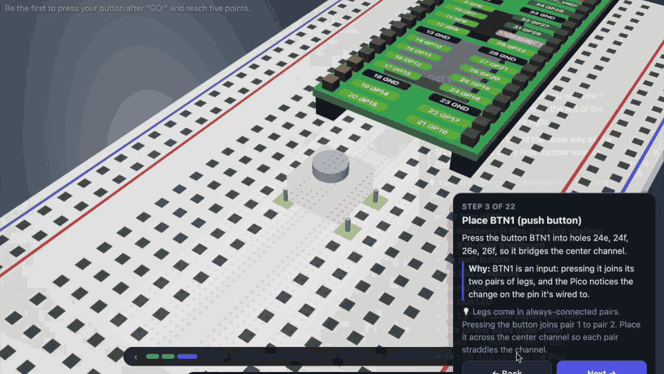
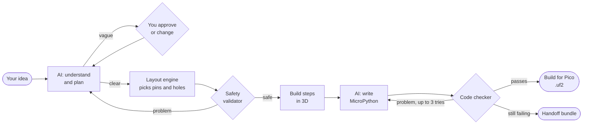
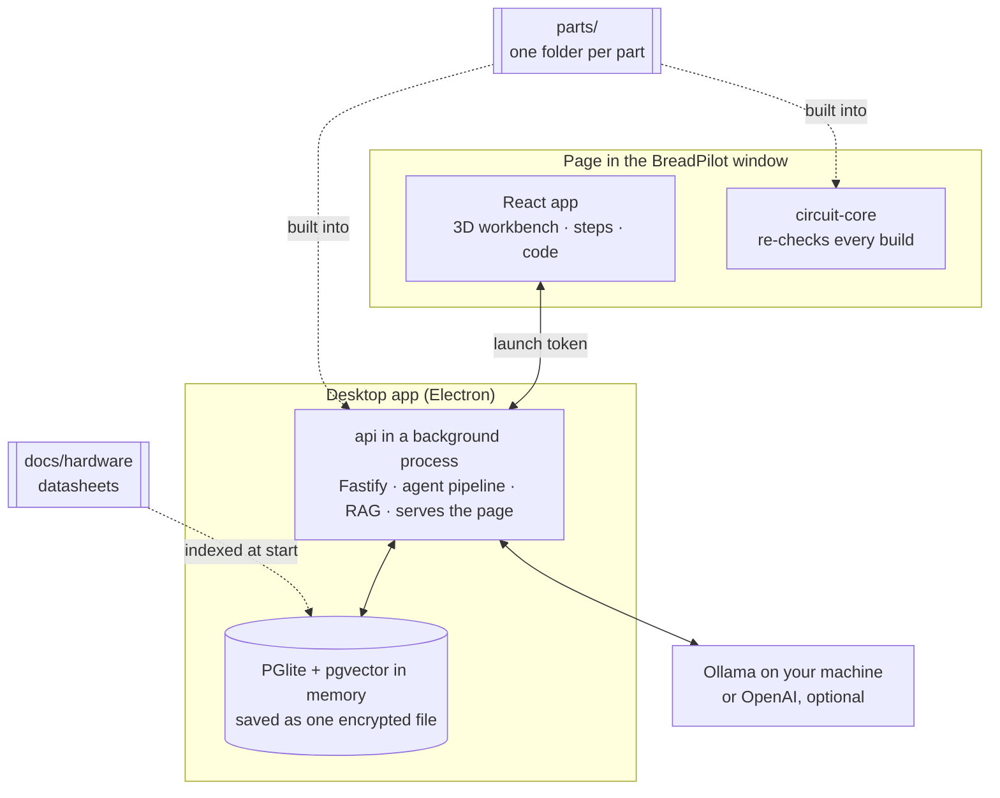

<p align="center">
  
</p>

<!-- A Markdown heading (not an HTML <h1>): tools such as the AppImage catalog read the app's name from it. -->
<div align="center">

# BreadPilot

</div>

<p align="center"><strong>Describe a hardware project in plain words. Build it step by step on a 3D breadboard.</strong></p>

<p align="center">
  <a href="https://github.com/Prestical/BreadPilot/releases/latest"></a>
  <a href="https://github.com/Prestical/BreadPilot/releases/latest"></a>
  <a href="https://github.com/Prestical/BreadPilot/releases"></a>
  
  <a href="LICENSE"></a>
</p>

<p align="center">
  <a href="https://github.com/Prestical/BreadPilot/releases/latest"></a>
</p>

<p align="center">
  <a href="#quick-start">Install</a> ·
  <a href="#using-the-app">Usage</a> ·
  <a href="#supported-hardware">Supported hardware</a> ·
  <a href="#uninstalling">Uninstall</a>
</p>

<p align="center">
  
</p>

BreadPilot turns an idea like *"blink an LED when I press a button"* into a checked circuit for
the **Raspberry Pi Pico 2 W**, numbered wiring steps in an interactive 3D scene, and MicroPython
code you can flash to the board in one click. It runs on your own computer with a local AI model.

> **The AI writes words; code checks the physics.** The AI only understands your idea and drafts
> text and code. Pin choices, breadboard layout and every safety rule are plain code, so a step is
> never shown unless the circuit passed the safety check.

---

## Contents

- [What it does](#what-it-does)
- [Demo](#demo)
- [Quick start](#quick-start)
- [Using the app](#using-the-app)
- [Choosing a local model](#choosing-a-local-model)
- [Supported hardware](#supported-hardware)
- [How it works](#how-it-works)
- [Project structure](#project-structure)
- [Adding a new part](#adding-a-new-part)
- [Development](#development)
- [Your data](#your-data)
- [Uninstalling](#uninstalling)
- [Contributing](#contributing)
- [License](#license)

---

## What it does

| | |
|---|---|
| 💬 **Idea → plan** | Type an idea. Clear ideas are planned at once; vague ones get a short plan for you to approve or change. |
| 🛡️ **Safe wiring** | Code picks the pins, places the parts and draws every wire, then a validator checks for shorts, missing resistors, 5 V on a GPIO and more. |
| 🧊 **3D steps** | Each step pops up next to its part or wire, with a plain-English "why". Hover any hole to see what it's connected to. |
| 🐍 **Checked code** | MicroPython is generated and cross-checked against your wiring before you see it. You can edit it; edits are re-checked live. |
| ⬇️ **Build for Pico** | One `.uf2` file with MicroPython and your code. Drag it onto the Pico and it runs. |
| 🔒 **Local first** | A desktop app for macOS, Windows and Linux, with a local AI model through [Ollama](https://ollama.com). Your projects are stored encrypted on your computer. An OpenAI model is optional, per project. |

---

## Demo

A 40-second tour: describe a two-player reaction game, follow the 3D steps, check the code and
build the Pico file.

https://github.com/user-attachments/assets/0161edb4-e6da-4555-9ad4-219627323e4f

---

## Quick start

1. **Download BreadPilot** for your computer from the
   [latest release](https://github.com/Prestical/BreadPilot/releases/latest):
   `BreadPilot-…-arm64.dmg` (Mac with Apple silicon), `BreadPilot-…-x64.dmg` (Intel Mac, not
   tested yet), `BreadPilot-…-Setup.exe` (Windows 10 and 11) or `BreadPilot-…-x86_64.AppImage` (Linux).
2. **Install [Ollama](https://ollama.com/download)** for the free local AI, or skip it and use an
   OpenAI key instead.
3. **Open BreadPilot.** A short setup checks Ollama, lets you pick and download a local AI model
   with one click (the default is 2.5 GB) and, if you like, takes an OpenAI key. A guided tour shows
   the rest.

BreadPilot isn't signed with a paid developer certificate yet, so the first start needs one extra
click:

| System | First start |
|---|---|
| **macOS** | See the steps below. |
| **Windows** | Run the setup (no administrator rights needed). If Windows says "Windows protected your PC", click **More info → Run anyway**. |
| **Linux** | Make the AppImage executable (`chmod +x BreadPilot-*.AppImage`) and run it. If it doesn't start, install FUSE (`sudo apt install libfuse2`, on Ubuntu 24.04 `libfuse2t64`). BreadPilot keeps its key in your keyring (GNOME Keyring or KWallet). |

**macOS, first start** (macOS 15 Sequoia and newer):

1. Open the `.dmg` and drag **BreadPilot** into **Applications**.
2. Open BreadPilot from Applications. macOS says *"Apple could not verify 'BreadPilot' is free of
   malware…"*. Click **Done** (not *Move to Trash*).
3. Open **System Settings → Privacy & Security**, scroll down to *"'BreadPilot' was blocked…"* and
   click **Open Anyway** (it's shown for about an hour after step 2). Enter your Mac password if asked.
4. Click **Open** in the last question. From then on BreadPilot opens normally, also after updates
   installed the same way.

On macOS 14 and older: right-click BreadPilot in Applications → **Open** → **Open**.

This is macOS's check for apps without a paid Apple Developer ID; it isn't a password for
BreadPilot. BreadPilot never asks for your keychain password (see [Your data](#your-data)).

Your projects are saved encrypted on your computer (see [Your data](#your-data)). The OpenAI key,
if you add one in **⚙ Settings**, is stored encrypted too and only ever sent to OpenAI.

<details>
<summary><strong>Run from the source code</strong> (developers)</summary>

You need [Node.js](https://nodejs.org) 22 or newer and Ollama.

```bash
npm install
node node_modules/electron/install.js     # once: downloads Electron (npm 11 skips its install step)
npm run dev:desktop
```

</details>

---

## Using the app

1. **Type an idea** in the box at the bottom (or pick an example) and press Enter.
2. **Watch the progress card**: reading the idea → plan → parts → safety check → code.
3. **Approve the plan** if asked, or type a change in the same box.
4. **Build step by step.** Use *Next / Back*, the step strip or the ← → keys. The first step lists
   what you need; power always goes in last.
5. **Open `</> Code`** to read, copy, edit or download `main.py`, then press **⬇ Build for Pico**:
   hold BOOTSEL while plugging the Pico in, and drag the file onto the drive that appears.

New to breadboards? **Breadboard & Pico 101** in the sidebar is a short interactive tutorial.
The **⚡ Power** switch on the 3D view wires parts to the breadboard rails (default) or straight to
the Pico's pins; the code stays the same.

BreadPilot follows your system's light or dark appearance.

---

## Choosing a local model

Pick the local AI in the first-run setup or later in **⚙ Settings → Local AI**. The dropdown groups
the models by size, and each one shows its download size, the memory it needs and a warning if it
won't fit your computer:

```
Small (model under 4 GB)
  Qwen3 4B Instruct · 2.5 GB · 4.9 GB memory (default, downloaded)
Large (model 10 GB and more)
  Gemma 4 31B · 20.4 GB · 18.7 GB+ memory · ⚠ too big for this computer
```

- **Sizes** are Ollama's own numbers, built into BreadPilot. The app doesn't go online to get them.
- **Memory** is checked on your computer: after a download, BreadPilot loads the model once in your
  local Ollama and saves how much memory it really uses. Until then it shows the least it needs
  ("2.5 GB+"). Nothing leaves your computer.
- **Pick a downloaded model** and it's used at once; for others press **Download and use**. The
  model's name then shows on the button next to the idea box.
- **Which one?** Start with the default. Bigger models may write better code but are slower and need
  more memory; leave a few GB free for your system and the 3D view. Models with a warning may be very
  slow or not start.

---

## Supported hardware

| Part | Notes |
|---|---|
| Raspberry Pi Pico 2 W / 2 WH | The board. Its on-board LED, temperature sensor and Wi-Fi need no extra parts. |
| LED (5 mm) | Red, green, yellow, blue or white. Its resistor is added for you. |
| Push button (6 mm) | Read with the Pico's internal pull-up. |
| Potentiometer (10 kΩ knob) | Analog input, up to 3 (the Pico has 3 ADC pins). |
| 1.3" I2C OLED (SH1106, 128x64) | Up to 2. **Power from 3.3 V only.** Its driver `sh1106.py` is included in the Pico build. |

Ideas that need other parts (motors, sensors, other displays…) get a **handoff bundle**: the plan,
validated wiring and requirements as Markdown, ready to paste into a stronger assistant.

---

## How it works

### From idea to a working board



| Stage | Who does it |
|---|---|
| Understand the idea, write the plan, write the code | AI model (small, focused prompts with a fixed JSON format) |
| Pick pins, place parts, route wires, write the steps and their "why" | Code (`packages/circuit-core`) |
| Check the circuit (shorts, resistors, voltages, pin functions) | Code: the validator, in the API **and** again in your browser |
| Check the code against the wiring | Code: the MicroPython checker |

### System overview



- **Part packs** (`parts/`) are built into the app: the AI gets their exact facts in its prompts,
  and the layout, validator and checker read the same data.
- **Documentation search (RAG)** indexes the datasheets and the verified pinout when the API starts
  (hybrid vector + full-text search) and adds the most relevant paragraphs to the code prompt.
- **The database** is PGlite (Postgres compiled to WebAssembly) running inside the app. It is
  saved as one AES-256-GCM encrypted file; the key is protected by your operating system's secure
  storage (macOS Keychain, Windows DPAPI, Linux keyring).

---

## Project structure

```text
BreadPilot/
├── apps/
│   ├── desktop/          Electron: the window, the launch token, the database key
│   ├── web/              React + Vite + react-three-fiber: 3D workbench, steps, code panel
│   └── api/              Fastify: agent pipeline, documentation search, projects, PGlite database
├── packages/
│   └── circuit-core/     Shared TypeScript: connection format, validator, layout, steps,
│                         code checker, part pack loader, UF2 builder
├── parts/                Part packs: one folder per part
├── data/                 Verified board and breadboard data, tutorial, eval sets, firmware
├── docs/                 Datasheets and MicroPython source facts
└── db/migrations/        SQL, applied when the API starts
```

---

## Adding a new part

Every part is **one folder** in `parts/`. The engine has no code for any particular part.

```text
parts/oled-sh1106-i2c/
├── pack.json       id, review status, plan name, driver
├── part.json       legs, elements, specs: every fact with its source (datasheet page, …)
├── layout.json     how it sits on the breadboard and is wired
├── text.json       build-step texts and names in the app
├── view.json       3D look (from a small set of shapes)
├── code.json       code-checker rules
├── agent.json      what the AI needs: words, plan line, pin setup line
├── driver/         MicroPython driver, if any
├── tests/          good and bad wirings and programs
└── SOURCES.md      documents used and who reviewed them
```

Packs are **data only** and are **reviewed by a person**; a pack marked `draft` is left out. A part
that needs something the engine doesn't support yet (1-Wire, SPI, UART, servo pulses, a new 3D
shape) needs that added to the engine once. Full format: [`parts/README.md`](parts/README.md).

---

## Development

```bash
npm install
npm run dev:api                 # API on http://127.0.0.1:3000 (data in .local/data)
npm run dev:web                 # web on http://localhost:5173 (proxies /api), with hot reload
npm run dev:desktop             # or: the whole desktop app
```

```bash
npm run typecheck
npm test
```

- `npm test`, the dev servers, type checks and builds first run `npm run gen:parts`, which copies
  the part packs into a generated file (not committed). Run it by hand after changing a pack while a
  dev server is running.
- The driver test runs under `python3` when it's installed. One Pico build test also mounts the
  filesystem with littlefs-python when you set `LITTLEFS_PYTHON=<folder>`; otherwise it's skipped.
- After adding or changing a datasheet in `docs/hardware/`, restart the API: new or changed
  documents are indexed when it starts.
- Only one program can use a data folder at a time (it holds `data.lock`): stop `npm run dev:api`
  before running the command-line tools below.

<details>
<summary><strong>Building the installers</strong></summary>

```bash
npm run template -w @breadpilot/api         # ready-made database: needs Ollama with nomic-embed-text
npm run dist:mac -w @breadpilot/desktop     # or dist:linux, dist:win
```

Each build stages the app, checks it for leaks, builds, checks the installers again and then
removes everything but the installers.

The installers land in `apps/desktop/release/`. The app is built from an allowlist
(`apps/desktop/scripts/stage.mjs`), and `apps/desktop/scripts/check-leaks.mjs` fails the build if
the app contains your home folder path, user name, computer name, git e-mail address, the OpenAI
key from `.env`, the development key, anything shaped like an OpenAI key, or private files
(`.env`, `.local`, notes, `.claude`, source maps). Only the installers stay in `release/`; a Mac can
build all three systems' installers.

</details>

<details>
<summary><strong>API and command-line tools</strong></summary>

```bash
# Projects
# (development API; the desktop app needs its launch token)
curl -s -X POST 'http://127.0.0.1:3000/api/projects?async=1' -H 'Content-Type: application/json' \
     -d '{"idea":"Blink an LED"}'                                    # 202, runs in the background
curl -N http://127.0.0.1:3000/api/projects/<id>/events               # live progress (server-sent events)
curl -s http://127.0.0.1:3000/api/projects/<id>/handoff              # handoff bundle (Markdown)

# Documentation search
curl -s -X POST http://127.0.0.1:3000/api/rag/search -H 'Content-Type: application/json' \
     -d '{"query":"Which pins are ADC?","k":3}'
npm run ingest -w @breadpilot/api [-- --force]                      # re-index documents
npm run eval:rag -w @breadpilot/api                                 # retrieval eval

# Agent eval (ideas in data/eval/)
npm run eval:agent -w @breadpilot/api -- [--model <name>] [--openai] [--json <file>]

# Model test: 50 ideas (20 easy, 20 medium, 10 hard), results per difficulty + the model's memory
# Reloads the model between ideas, prints memory after each, stops if swap grows more than 2 GB
npm run eval:models -w @breadpilot/api -- --model <ollama tag> [--json <file>] [--think on|off] [--max-swap-gb <n>] [--keep-loaded]

# New parts test: 10 projects with the slide switch, buzzer and DHT11 (3 easy, 4 medium, 3 hard)
npm run eval:parts -w @breadpilot/api -- [--openai] [--model <ollama tag>] [--json <file>]

# Change test: builds 5 projects, asks for one change each, checks the parts that stay didn't move
npm run eval:changes -w @breadpilot/api -- [--openai] [--model <ollama tag>] [--only 1,3] [--json <file>]

# Compare the built-in model sizes with ollama.com (--write updates them)
npm run check:models -w @breadpilot/api [-- --write]
```

Project states: `AWAIT_APPROVAL` (approve with `POST /api/projects/<id>/approve`, optionally
`{"feedback":"..."}`), `READY`, `HANDOFF`, `FAILED` (retry with `POST /api/projects/<id>/retry`).

</details>

---

## Your data

| | Where |
|---|---|
| macOS | `~/Library/Application Support/BreadPilot/` |
| Windows | `%APPDATA%\BreadPilot\` |
| Linux | `~/.config/BreadPilot/` |

`data/data.enc` holds your projects and the documentation index, encrypted with a key that only
your operating system can unlock (see below). Closing the app saves everything. Deleting the folder resets
BreadPilot and **deletes your projects**. Running the desktop app from the source code
(`npm run dev:desktop`) uses a separate **BreadPilot Dev** folder and keychain entry, so it never
touches an installed BreadPilot's projects or key. The development API (`npm run dev:api`) keeps its
own data in `.local/data/` with a development key.

On macOS the key lives in your login keychain as **BreadPilot data key**, saved and read through
Apple's built-in `security` tool, so BreadPilot never asks for your password, not even after an
update. It's encrypted with your login password: a copy of your disk or a backup can't open your
projects. The tradeoff, until BreadPilot is signed with an Apple Developer ID: another program you
run on your Mac could read that entry without asking. On Windows and Linux, `key.bin` holds the key,
encrypted by the operating system. On Linux with no keyring (such as GNOME Keyring or KWallet),
BreadPilot keeps the key in `key.plain`, readable only by your user account, and doesn't save an
OpenAI key; the next start after a keyring is installed or unlocked moves the key into it.

---

## Uninstalling

Removing the app **keeps your projects**, so a reinstall picks up where you left off. To remove
everything, also delete the data folder (this **deletes your projects**) and the key.

**macOS**

1. Quit BreadPilot (⌘Q).
2. Drag **BreadPilot** from **Applications** to the Trash.
3. To remove everything: delete `~/Library/Application Support/BreadPilot` (in Finder: Go → Go to
   Folder…) and the key, either in **Keychain Access** (search "BreadPilot data key", delete it) or
   in Terminal:

   ```bash
   security delete-generic-password -s "BreadPilot data key"
   ```

**Windows**

1. Quit BreadPilot.
2. **Settings → Apps → Installed apps → BreadPilot → Uninstall**.
3. To remove everything: delete the folder `%APPDATA%\BreadPilot` (paste it into the File Explorer
   address bar). The key is inside it.

**Linux (AppImage)**

1. Quit BreadPilot and delete the `BreadPilot-….AppImage` file.
2. To remove everything: delete `~/.config/BreadPilot`, and the entry "BreadPilot Safe Storage" in
   your keyring app (for example **Passwords and Keys**).

Ran BreadPilot from the source code? Its data is in a separate **BreadPilot Dev** folder (same
places) with the keychain entry "BreadPilot Dev data key".

---

## Contributing

Contributions are welcome: bug reports, new part packs, documentation and fixes. A new part is
usually just one folder in `parts/` (see [Adding a new part](#adding-a-new-part)). Run
`npm run typecheck` and `npm test` before opening a pull request.

---

## License

BreadPilot is licensed under the **[Apache License 2.0](LICENSE)**: you may use, change and
share it, also commercially. If you redistribute it or build on it, keep the [`NOTICE`](NOTICE) file
and its credit to the original project and author, and mark the files you changed.

Third-party files (MicroPython firmware, datasheets, npm packages) keep their own licenses: see
[`THIRD_PARTY_NOTICES.md`](THIRD_PARTY_NOTICES.md).

> ⚠️ BreadPilot gives wiring and code suggestions for real electronics. Its checks can be
> incomplete and AI output can be wrong. Always check your wiring before plugging in the USB cable.
