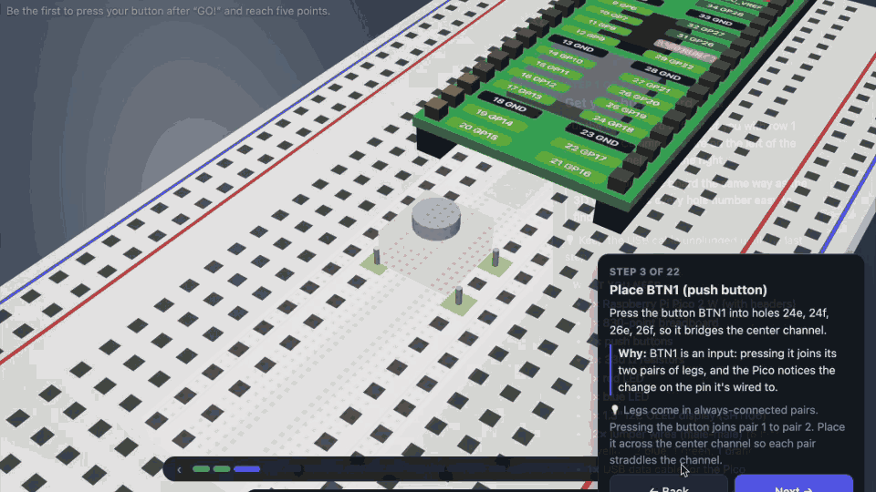
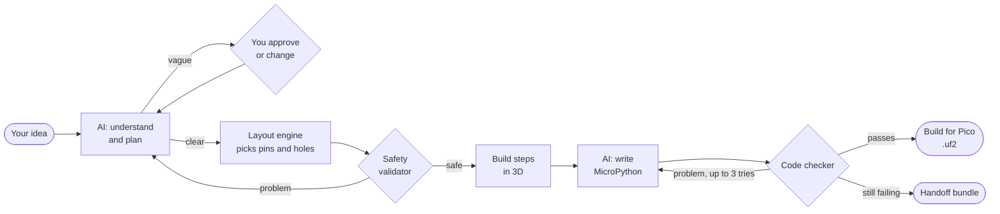
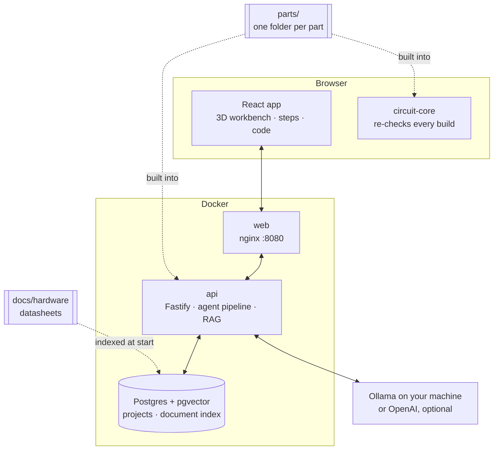

# BreadPilot

**Describe a hardware project in plain words. Build it step by step on a 3D breadboard.**

<p align="center">
  
</p>

BreadPilot turns an idea like *"blink an LED when I press a button"* into a checked circuit for
the **Raspberry Pi Pico 2 W**, numbered wiring steps in an interactive 3D scene, and MicroPython
code you can flash to the board in one click. It runs on your own computer with a local AI model.

> **The AI writes words; code checks the physics.** The AI only understands your idea and drafts
> text and code. Pin choices, breadboard layout and every safety rule are plain code, so a step is
> never shown unless the circuit passed the safety check.

---

## Contents

- [What it does](#what-it-does)
- [Demo](#demo)
- [Quick start](#quick-start)
- [Using the app](#using-the-app)
- [Supported hardware](#supported-hardware)
- [How it works](#how-it-works)
- [Project structure](#project-structure)
- [Adding a new part](#adding-a-new-part)
- [Development](#development)
- [Stopping the app](#stopping-the-app)
- [Contributing](#contributing)
- [License](#license)

---

## What it does

| | |
|---|---|
| 💬 **Idea → plan** | Type an idea. Clear ideas are planned at once; vague ones get a short plan for you to approve or change. |
| 🛡️ **Safe wiring** | Code picks the pins, places the parts and draws every wire, then a validator checks for shorts, missing resistors, 5 V on a GPIO and more. |
| 🧊 **3D steps** | Each step pops up next to its part or wire, with a plain-English "why". Hover any hole to see what it's connected to. |
| 🐍 **Checked code** | MicroPython is generated and cross-checked against your wiring before you see it. You can edit it; edits are re-checked live. |
| ⬇️ **Build for Pico** | One `.uf2` file with MicroPython and your code. Drag it onto the Pico and it runs. |
| 🔒 **Local first** | Runs in Docker on your own machine (Linux, Windows or macOS) with [Ollama](https://ollama.com). An OpenAI model is optional, per project. |

---

## Demo

A 40-second tour: describe a two-player reaction game, follow the 3D steps, check the code and
build the Pico file.

https://github.com/user-attachments/assets/0161edb4-e6da-4555-9ad4-219627323e4f

---

## Quick start

Works on **Linux, Windows and macOS**. You need:

- **Docker** with Compose v2 (Docker Engine or Docker Desktop)
- **[Ollama](https://ollama.com)** for the local AI model (or run it inside Docker, see below)

```bash
cp .env.example .env            # then set POSTGRES_PASSWORD
ollama pull qwen3:4b-instruct-2507-q4_K_M
ollama pull nomic-embed-text
docker compose up -d --build
```

Open **http://localhost:8080**. The status line in the sidebar shows whether the database, the AI
model and the documentation search are ready. On Linux and macOS, `chmod 600 .env` keeps your
password and keys readable only by you.

<details>
<summary><strong>Notes per operating system</strong></summary>

| System | Ollama | Notes |
|---|---|---|
| **macOS** | Install the Ollama app and keep it running. | Run Ollama natively, not in Docker: Docker on macOS can't use the Apple GPU. Tested. |
| **Windows** | Install Ollama for Windows. | Use Docker Desktop (WSL 2 backend). Containers reach Ollama at `host.docker.internal`. Not tested yet. |
| **Linux** | Install Ollama, then let containers reach it: run `sudo systemctl edit ollama`, add `[Service]` / `Environment="OLLAMA_HOST=0.0.0.0"`, and restart it. Or skip installing it and use **Ollama in Docker** below. | Ollama listens only on `127.0.0.1` by default, which containers can't reach. With `0.0.0.0` it's reachable from your network too, so keep a firewall on port 11434. Not tested yet. |

**Ollama in Docker** (any system, no install): add `DOCKER_LLM_BASE_URL=http://ollama:11434/v1`
to `.env`, then

```bash
docker compose --profile ollama up -d --build
docker compose exec ollama ollama pull qwen3:4b-instruct-2507-q4_K_M
docker compose exec ollama ollama pull nomic-embed-text
```

It runs on the CPU (slower). For an NVIDIA GPU on Linux, install the NVIDIA Container Toolkit and
add `gpus: all` to the `ollama` service in `docker-compose.yml`.

</details>

**Optional:** put an `OPENAI_API_KEY` in `.env` to offer OpenAI's model in the model menu. Projects
that use it send their idea, plan and code to OpenAI and are billed to your key.

---

## Using the app

1. **Type an idea** in the box at the bottom (or pick an example) and press Enter.
2. **Watch the progress card**: reading the idea → plan → parts → safety check → code.
3. **Approve the plan** if asked, or type a change in the same box.
4. **Build step by step.** Use *Next / Back*, the step strip or the ← → keys. The first step lists
   what you need; power always goes in last.
5. **Open `</> Code`** to read, copy, edit or download `main.py`, then press **⬇ Build for Pico**:
   hold BOOTSEL while plugging the Pico in, and drag the file onto the drive that appears.

New to breadboards? **Breadboard & Pico 101** in the sidebar is a short interactive tutorial.
The **⚡ Power** switch on the 3D view wires parts to the breadboard rails (default) or straight to
the Pico's pins; the code stays the same.

---

## Supported hardware

| Part | Notes |
|---|---|
| Raspberry Pi Pico 2 W / 2 WH | The board. Its on-board LED, temperature sensor and Wi-Fi need no extra parts. |
| LED (5 mm) | Red, green, yellow, blue or white. Its resistor is added for you. |
| Push button (6 mm) | Read with the Pico's internal pull-up. |
| Potentiometer (10 kΩ knob) | Analog input, up to 3 (the Pico has 3 ADC pins). |
| 1.3" I2C OLED (SH1106, 128x64) | Up to 2. **Power from 3.3 V only.** Its driver `sh1106.py` is included in the Pico build. |

Ideas that need other parts (motors, sensors, other displays…) get a **handoff bundle**: the plan,
validated wiring and requirements as Markdown, ready to paste into a stronger assistant.

---

## How it works

### From idea to a working board



| Stage | Who does it |
|---|---|
| Understand the idea, write the plan, write the code | AI model (small, focused prompts with a fixed JSON format) |
| Pick pins, place parts, route wires, write the steps and their "why" | Code (`packages/circuit-core`) |
| Check the circuit (shorts, resistors, voltages, pin functions) | Code: the validator, in the API **and** again in your browser |
| Check the code against the wiring | Code: the MicroPython checker |

### System overview



- **Part packs** (`parts/`) are built into the app: the AI gets their exact facts in its prompts,
  and the layout, validator and checker read the same data.
- **Documentation search (RAG)** indexes the datasheets and the verified pinout when the API starts
  (hybrid vector + full-text search) and adds the most relevant paragraphs to the code prompt.

---

## Project structure

```text
BreadPilot/
├── apps/
│   ├── web/              React + Vite + react-three-fiber: 3D workbench, steps, code panel
│   └── api/              Fastify: agent pipeline, documentation search, projects
├── packages/
│   └── circuit-core/     Shared TypeScript: connection format, validator, layout, steps,
│                         code checker, part pack loader, UF2 builder
├── parts/                Part packs: one folder per part
├── data/                 Verified board and breadboard data, tutorial, eval sets, firmware
├── docs/                 Datasheets and MicroPython source facts
└── db/migrations/        SQL, applied when the API starts
```

---

## Adding a new part

Every part is **one folder** in `parts/`. The engine has no code for any particular part.

```text
parts/oled-sh1106-i2c/
├── pack.json       id, review status, plan name, driver
├── part.json       legs, elements, specs: every fact with its source (datasheet page, …)
├── layout.json     how it sits on the breadboard and is wired
├── text.json       build-step texts and names in the app
├── view.json       3D look (from a small set of shapes)
├── code.json       code-checker rules
├── agent.json      what the AI needs: words, plan line, pin setup line
├── driver/         MicroPython driver, if any
├── tests/          good and bad wirings and programs
└── SOURCES.md      documents used and who reviewed them
```

Packs are **data only** and are **reviewed by a person**; a pack marked `draft` is left out. A part
that needs something the engine doesn't support yet (1-Wire, SPI, UART, servo pulses, a new 3D
shape) needs that added to the engine once. Full format: [`parts/README.md`](parts/README.md).

---

## Development

```bash
npm install
docker compose up -d db         # Postgres + pgvector on 127.0.0.1:5433
npm run dev:api                 # API on http://127.0.0.1:3000
npm run dev:web                 # web on http://localhost:5173 (proxies /api)
```

```bash
npm run typecheck
npm test
```

- `npm test`, the dev servers, type checks and builds first run `npm run gen:parts`, which copies
  the part packs into a generated file (not committed). Run it by hand after changing a pack while a
  dev server is running.
- The driver test runs under `python3` when it's installed. One Pico build test also mounts the
  filesystem with littlefs-python when you set `LITTLEFS_PYTHON=<folder>`; otherwise it's skipped.
- After adding or changing a datasheet in `docs/hardware/`, rebuild with
  `docker compose up -d --build` (documents are copied into the API image and indexed at start).

<details>
<summary><strong>API and command-line tools</strong></summary>

```bash
# Projects
curl -s -X POST 'http://localhost:8080/api/projects?async=1' -H 'Content-Type: application/json' \
     -d '{"idea":"Blink an LED"}'                                    # 202, runs in the background
curl -N http://localhost:8080/api/projects/<id>/events               # live progress (server-sent events)
curl -s http://localhost:8080/api/projects/<id>/handoff              # handoff bundle (Markdown)

# Documentation search
curl -s -X POST http://localhost:8080/api/rag/search -H 'Content-Type: application/json' \
     -d '{"query":"Which pins are ADC?","k":3}'
docker compose exec api node dist/ingest-cli.js [--force]           # re-index documents
docker compose exec api node dist/eval-rag-cli.js                   # retrieval eval

# Agent eval (ideas in data/eval/)
docker compose exec api node dist/eval-agent-cli.js [--model <name>] [--openai] [--json <file>]
```

Project states: `AWAIT_APPROVAL` (approve with `POST /api/projects/<id>/approve`, optionally
`{"feedback":"..."}`), `READY`, `HANDOFF`, `FAILED` (retry with `POST /api/projects/<id>/retry`).

</details>

---

## Stopping the app

| Goal | Command | Your projects |
|---|---|---|
| Pause | `docker compose stop` | kept |
| Stop and remove containers | `docker compose down` | kept |
| Full reset ⚠️ | `docker compose down -v` | **deleted** |

Start again with `docker compose up -d` (add `--profile ollama` if you run Ollama in Docker). A
natively installed Ollama runs outside Docker: stop it the way your system runs it (the app, or
`systemctl stop ollama` on Linux).

---

## Contributing

Contributions are welcome: bug reports, new part packs, documentation and fixes. A new part is
usually just one folder in `parts/` (see [Adding a new part](#adding-a-new-part)). Run
`npm run typecheck` and `npm test` before opening a pull request.

---

## License

BreadPilot is licensed under the **[Apache License 2.0](LICENSE)**: you may use, change and
share it, also commercially. If you redistribute it or build on it, keep the [`NOTICE`](NOTICE) file
and its credit to the original project and author, and mark the files you changed.

Third-party files (MicroPython firmware, datasheets, npm packages) keep their own licenses: see
[`THIRD_PARTY_NOTICES.md`](THIRD_PARTY_NOTICES.md).

> ⚠️ BreadPilot gives wiring and code suggestions for real electronics. Its checks can be
> incomplete and AI output can be wrong. Always check your wiring before plugging in the USB cable.
